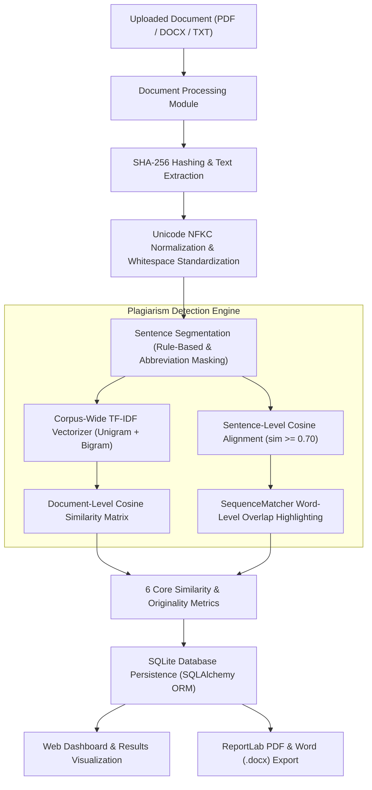

# PlagiarismAI: AI-Based Plagiarism Detection System

> **"Verify Originality. Protect Academic Integrity."**  
> An AI/ML-powered academic document analysis and plagiarism detection platform built for undergraduate Computer Science & Engineering research, education, and institutional content verification.

---

## 1. Project Overview

**PlagiarismAI** is a full-featured, locally runnable web application engineered to detect, quantify, and report textual similarity across academic papers, student essays, and research manuscripts. 

Rather than relying on black-box external services or paid cloud APIs, PlagiarismAI operates completely offline on your local computer. It utilizes Natural Language Processing (NLP), **TF-IDF (Term Frequency-Inverse Document Frequency) vectorization**, and **Cosine Similarity** to compute mathematical document similarity, align sentence-level matching passages, and highlight overlapping phrases.

### Key Highlights
- **100% Genuine Machine Learning Engine:** Computes real Cosine Similarity matrices and sentence alignments—no fabricated scores or hardcoded results.
- **Multi-Format Ingestion:** Native parsing of **PDF (.pdf)**, **Microsoft Word (.docx)**, and **Plain Text (.txt)** documents with UTF-8 BOM and multi-encoding fallbacks.
- **Deduplicated Textual Coverage & Originality:** Measures exact proportion of submitted text linked to flagged matches and computes an intuitive Originality Index ($100 - \text{Max Similarity}$).
- **Inline Word-Level Diff Highlighting:** Identifies matching sub-phrases between submitted and reference sentences using SequenceMatcher token alignment.
- **Cryptographic Duplicate Detection:** Uses SHA-256 file hashing to detect duplicate uploads and prevent redundant processing.
- **Publication-Quality Reports:** Exports downloadable academic reports in both **PDF (ReportLab with two-pass canvas & repeat table headers)** and **Word (.docx)**.
- **Modular Subsystems:** Clean extension points for **OCR (Tesseract)** for scanned PDFs and **Semantic Embeddings (Sentence-Transformers)**.
- **Enterprise-Grade UI/UX:** Responsive academic dashboard adhering to dark navy and white design aesthetics with interactive Chart.js analytics.
- **Automated Test Suite:** 28 comprehensive pytest tests validating extraction, vectorization, security, reports, and UI workflows.

---

## 2. Problem Statement & Objectives

### Problem Statement
In higher education and scholarly publishing, verifying the originality of student submissions and research manuscripts is critical to upholding academic integrity. Conventional commercial tools often:
1. Demand expensive subscription fees and proprietary cloud uploads, violating institutional data privacy.
2. Provide aggregate percentage scores without granular sentence-level alignment or explainability.
3. Fail to distinguish between verbatim copying, legitimate citations, and domain-specific terminology.

### Project Objectives
1. **Develop an Accessible Local Engine:** Provide an open-source, reproducible plagiarism detection system that runs entirely on local commodity hardware without external network calls.
2. **Implement Dual-Level Text Comparison:** Calculate both high-level document cosine similarity and granular sentence-level alignment with configurable similarity thresholds.
3. **Offer Transparent & Explainable Metrics:** Clearly distinguish between maximum document similarity, average reference similarity, matched sentence count, text coverage, and originality score.
4. **Ensure Security & Reliability:** Safeguard against directory traversal attacks, invalid file formats, corrupted PDFs, and state loss upon server restarts.

---

## 3. System Architecture & Methodology



### Mathematical Methodology

1. **TF-IDF Vectorization:**
   Given a corpus of submitted document $d$ and reference documents $R = \{r_1, r_2, \dots, r_n\}$, the Term Frequency-Inverse Document Frequency weight for term $t$ in document $d$ is:
   $$\text{TF-IDF}(t, d, D) = \text{TF}(t, d) \times \log\left(\frac{1 + |D|}{1 + |\{d' \in D : t \in d'\}|}\right) + 1$$
   Sublinear term frequency scaling is applied to attenuate the impact of repetitive terminology. Both unigram and bigram features are incorporated.

2. **Cosine Similarity:**
   The textual resemblance between submitted vector $\vec{u}$ and reference vector $\vec{v}$ is evaluated in Euclidean space as the cosine of the angle between them:
   $$\text{Cosine Similarity}(\vec{u}, \vec{v}) = \frac{\vec{u} \cdot \vec{v}}{\|\vec{u}\|_2 \|\vec{v}\|_2} = \frac{\sum_{k=1}^m u_k v_k}{\sqrt{\sum_{k=1}^m u_k^2} \sqrt{\sum_{k=1}^m v_k^2}}$$
   The resulting value ranges from $0.0$ to $1.0$ and is scaled to $0.0\% - 100.0\%$.

3. **Sentence Alignment & Filtering:**
   Sentences with length $\ge 20$ characters are extracted and vectorized. For each candidate pair $(s_i, r_j)$, a match is registered if:
   $$\text{sim}(s_i, r_j) \ge \tau_{\text{sentence}} \quad (\text{default } \tau = 0.70)$$

4. **Deduplicated Textual Coverage:**
   The fraction of submitted text directly covered by flagged matches without double-counting sentences that match multiple reference documents:
   $$\text{Coverage (\%)} = \left(\frac{\sum_{s \in S_{\text{unique\_matched}}} \text{Length}(s)}{\sum_{s \in S_{\text{all}}} \text{Length}(s)}\right) \times 100$$

5. **Originality Score:**
   An inverted benchmark reflecting the proportion of novel formulation:
   $$\text{Originality Index (\%)} = 100.0\% - \text{Max Similarity (\%)} $$

6. **Standard Resemblance Bands:**
   - **Low:** Below 10%
   - **Moderate:** 10% to below 30%
   - **Elevated:** 30% to below 60%
   - **High:** 60% and above

---

## 4. Technology Stack

| Layer | Technologies Used |
| :--- | :--- |
| **Frontend** | HTML5, Vanilla CSS3 (Dark Navy / Indigo theme), Vanilla JavaScript, Jinja2, Chart.js 4.4 |
| **Backend Framework** | Python 3.12, Flask 3.1, Flask-SQLAlchemy 3.1, Flask-WTF 1.3 |
| **AI / Machine Learning** | scikit-learn (TfidfVectorizer, cosine_similarity), NumPy |
| **Modular Subsystems** | PyTesseract extension (`ocr_engine.py`), Sentence-Transformers extension (`semantic_engine.py`) |
| **Document Processing** | pypdf 6.2 (PDF extraction), python-docx 1.2 (Word extraction), Python built-in I/O |
| **Database** | SQLite3 via SQLAlchemy ORM |
| **Report Generation** | ReportLab 5.1 (Publication PDF with two-pass canvas & repeat table headers), python-docx |
| **Testing** | pytest 9.1, Flask Test Client |

---

## 5. Project Folder Structure

```
ai-plagiarism-detector/
├── app.py                      # Flask application factory, error handlers, CLI commands
├── config.py                   # Centralized configuration (dev, test, production)
├── extensions.py               # Shared extensions (SQLAlchemy, CSRFProtect)
├── requirements.txt            # Python dependencies
├── seed_data.py                # Academic demonstration data generator
├── README.md                   # Complete system documentation
├── .env.example                # Example environment variables
├── .gitignore                  # Git ignore rules
│
├── plagiarism/                 # Core AI & NLP Engine
│   ├── __init__.py             # Public exports
│   ├── preprocessing.py        # Text normalization, sentence segmenter & word diff highlighter
│   ├── plagiarism_engine.py    # TF-IDF, Cosine Similarity, coverage & statistics
│   ├── document_processor.py   # PDF, DOCX, and TXT extractors, SHA-256 hash & path security
│   ├── ocr_engine.py           # Optional Tesseract OCR backend extension point
│   ├── semantic_engine.py      # Optional Sentence-Transformers semantic backend extension point
│   └── report_generator.py     # ReportLab PDF & python-docx report generators
│
├── models/                     # Database Models
│   ├── __init__.py             # Model exports
│   └── document_models.py      # Document, Analysis, SimilarityResult, SentenceMatch, Setting
│
├── routes/                     # Application Blueprints
│   ├── __init__.py             # Route exports
│   ├── dashboard.py            # Dashboard metrics, distribution & format breakdowns
│   ├── documents.py            # Document library with pagination, details, safe deletion
│   ├── analysis.py             # Upload handler, SHA-256 duplicate alert, analysis runner, results & history
│   ├── reports.py              # Download handlers for PDF and Word reports
│   ├── settings.py             # Runtime threshold configuration & backend status view
│   └── methodology.py          # Detection engine methodology and project background
│
├── templates/                  # Jinja2 HTML Templates
│   ├── base.html               # Master layout with 8-item sidebar, breadcrumb, footer
│   ├── dashboard.html          # Dashboard with 6 summary cards & Chart.js distributions
│   ├── upload.html             # Drag-and-drop document upload with file validation
│   ├── analyze.html            # Document selection & reference status
│   ├── results.html            # Results view, 6 metrics, word diff cards, interactive filters
│   ├── documents.html          # Document library with search, filter tabs, pagination
│   ├── document_details.html   # Metadata, SHA-256 digest, page count, and text viewer
│   ├── history.html            # Historical analysis registry with filter controls & safe delete
│   ├── reports.html            # Available reports repository with direct download actions
│   ├── settings.html           # Configurable thresholds form & modular engine status cards
│   ├── methodology.html        # Comprehensive mathematical formulas & integrity guidelines
│   ├── 404.html                # Branded 404 error page
│   └── 500.html                # Branded 500 error page
│
├── static/                     # Static Web Assets
│   ├── css/
│   │   └── style.css           # Responsive stylesheet (Dark Navy sidebar / Indigo theme)
│   └── js/
│       ├── main.js             # Mobile sidebar, alerts, match search/filtering & jump-to-ref
│       ├── upload.js           # Drag-and-drop and upload progress handling
│       └── charts.js           # Chart.js similarity distribution & format breakdowns
│
├── uploads/                    # Local storage for uploaded files (.gitkeep)
├── reports/                    # Generated PDF and DOCX reports (.gitkeep)
├── instance/                   # SQLite database storage directory
│
└── tests/                      # Automated Test Suite (pytest)
    ├── __init__.py             # Test package initializer
    ├── conftest.py             # Pytest fixtures & synthetic file generators
    ├── test_app.py             # App lifecycle, restart persistence, pagination, methodology
    ├── test_uploads.py         # File upload, empty check, SHA-256 duplicates, path security
    ├── test_plagiarism_engine.py # TF-IDF, cosine similarity, word diffs, vocabulary, classification
    └── test_reports.py         # PDF and DOCX report generation & Unicode robustness
```

---

## 6. Installation & Setup Guide (Windows PowerShell)

### Prerequisites
- Windows 10/11 with **PowerShell**
- **Python 3.12** installed (or compatible Python 3.10+)

### Step-by-Step Instructions

#### 1. Open the Project Folder
```powershell
cd "e:\SEM 3\ARTIFICIAL INTELLIGNECE\Micro project"
```

#### 2. Create and Activate Virtual Environment
```powershell
# Create virtual environment:
python -m venv .venv

# Activate in PowerShell:
.\.venv\Scripts\Activate.ps1
```

> **Note:** If PowerShell displays an `Execution_Policies` restriction when activating, run:
> ```powershell
> Set-ExecutionPolicy -ExecutionPolicy RemoteSigned -Scope Process
> .\.venv\Scripts\Activate.ps1
> ```

#### 3. Install Dependencies
```powershell
pip install -r requirements.txt
```

#### 4. Configure Environment Variables
```powershell
Copy-Item .env.example .env
```

#### 5. Seed Demonstration Data (Optional)
To populate the database with synthetic academic papers across AI, Climate Science, and Databases:
```powershell
python seed_data.py
```

#### 6. Start the Flask Application
```powershell
python app.py
```

#### 7. Access in Your Browser
Open your browser and navigate to:
```
http://127.0.0.1:5000/
```

---

## 7. Navigation Structure & Feature Walkthrough

PlagiarismAI includes an **8-item navigation shell**:

1. **Dashboard (`/`):**
   - Displays real-time metrics calculated directly from SQLite: Total Documents, Reference Library count, Submitted count, Total Analyses, Average Similarity, and High-Resemblance findings.
   - Dual Chart.js visualizations: Similarity Distribution Doughnut chart and Document Format Breakdown bar chart.
2. **Upload Documents (`/upload`):**
   - Drag-and-drop or browse file uploads for `.pdf`, `.docx`, and `.txt`.
   - File size validation (up to 10 MB), zero-byte rejection, and SHA-256 duplicate warning.
   - User chooses document role: *Reference Document* (added to library) or *Document to Analyze*.
3. **New Analysis (`/analyze`):**
   - Visual indicator showing reference library status.
   - Select any uploaded student paper and run analysis with a single click.
4. **Document Library (`/documents`):**
   - Complete inventory of uploaded documents.
   - Filter by category (*All*, *Submitted*, *Reference*), file format (*PDF*, *DOCX*, *TXT*), and search by filename.
   - Server-side pagination with 10 documents per page.
   - Document detail inspection and safe deletion.
5. **Analysis History (`/history`):**
   - Search historical records by document name.
   - Filter by Status (*Completed*, *No References*, *Failed*), Similarity Category (*Low*, *Moderate*, *Elevated*, *High*), and Date range.
   - Sort by Newest, Oldest, Highest Similarity, or Lowest Similarity.
   - Safe individual analysis record deletion with CSRF protection.
6. **Reports (`/reports`):**
   - Repository of all analyses ready for PDF or Word download.
7. **Settings (`/settings`):**
   - Configurable sentence match threshold ($\tau$), minimum sentence length, max upload size, and similarity classification bands.
   - Real-time status cards for OCR and Semantic Embedding modular backends.
   - Safe factory defaults reset option.
8. **About / Methodology (`/methodology`):**
   - Full mathematical formulas (TF-IDF, Cosine Similarity, Coverage), system architecture flowchart, and institutional academic evaluation guidelines.

---

## 8. Automated Testing

The project includes an automated test suite executed with **pytest**, covering **28 unit, integration, and security tests**:

```powershell
.\.venv\Scripts\pytest -v
```

### Verified Test Cases:
| Test ID | Test Function | Verified Requirement | Status |
| :--- | :--- | :--- | :--- |
| **TEST 1** | `test_1_upload_valid_txt_document` | Validates uploading and parsing of `.txt` documents. | **PASSED** |
| **TEST 2** | `test_2_reject_unsupported_file_format` | Ensures invalid formats (`.py`, `.exe`, `.csv`) are rejected. | **PASSED** |
| **TEST 3** | `test_3_reject_empty_document` | Rejects 0-byte or whitespace-only files. | **PASSED** |
| **TEST 4** | `test_4_extract_text_from_valid_pdf` | Tests text extraction and page counting from valid PDF. | **PASSED** |
| **TEST 5** | `test_5_extract_text_from_valid_docx` | Tests text extraction from `.docx` documents. | **PASSED** |
| **TEST 6** | `test_6_compare_identical_documents` | Confirms identical texts yield $\approx 100\%$ similarity. | **PASSED** |
| **TEST 7** | `test_7_compare_substantially_overlapping_documents` | Confirms substantial text overlap yields elevated similarity. | **PASSED** |
| **TEST 8** | `test_8_compare_unrelated_documents` | Confirms unrelated texts yield low similarity ($<20\%$). | **PASSED** |
| **TEST 9** | `test_9_identify_matching_sentences` | Pinpoints sentence-level cosine alignment $\ge 0.70$. | **PASSED** |
| **TEST 10** | `test_10_handle_absence_of_reference_documents` | Handles empty reference libraries gracefully without fake results. | **PASSED** |
| **TEST 11** | `test_11_generate_and_download_pdf_report` | Validates ReportLab PDF generation and download route. | **PASSED** |
| **TEST 12** | `test_12_previous_analyses_remain_available_after_restart` | Confirms analyses persist across application restarts. | **PASSED** |
| **TEST 13** | `test_13_invalid_document_ids_produce_appropriate_errors` | Verifies 404 responses for non-existent document/analysis IDs. | **PASSED** |
| **TEST 14** | `test_14_deleting_reference_document_prevents_future_use` | Validates that deleted reference documents are excluded. | **PASSED** |
| **TEST 15** | `test_15_uploaded_filenames_cannot_escape_upload_directory` | Validates path traversal sanitization on file uploads. | **PASSED** |
| **TEST 16** | `test_word_diff_highlighting` | Validates inline `<mark>` tag generation for matching word spans. | **PASSED** |
| **TEST 17** | `test_empty_vocabulary_handling` | Confirms zero division protection on empty/punctuation vocabularies. | **PASSED** |
| **TEST 18** | `test_similarity_classification_bands` | Verifies academic resemblance threshold mapping (Low, Moderate, Elevated, High). | **PASSED** |
| **TEST 19** | `test_extension_engines_graceful_status` | Validates OCR and Semantic extension status reporting. | **PASSED** |
| **TEST 20** | `test_generate_and_download_docx_report` | Validates Word `.docx` report generation and download. | **PASSED** |
| **TEST 21** | `test_report_with_unicode_and_many_matches` | Validates ReportLab Unicode robustness with special symbols and em-dashes. | **PASSED** |
| **TEST 22** | `test_dashboard_renders_with_real_metrics` | Validates dynamic SQL metric calculations on dashboard. | **PASSED** |
| **TEST 23** | `test_settings_update_and_validation` | Validates runtime threshold persistence and range checks. | **PASSED** |
| **TEST 24** | `test_methodology_and_about_pages` | Validates `/methodology` and `/about` route rendering. | **PASSED** |
| **TEST 25** | `test_delete_analysis_record_preserves_documents` | Confirms deleting an analysis preserves shared reference documents. | **PASSED** |
| **TEST 26** | `test_documents_library_search_filter_pagination` | Validates library pagination, category filter, and search. | **PASSED** |
| **TEST 27** | `test_sha256_duplicate_warning` | Confirms duplicate SHA-256 hashes trigger informative notice. | **PASSED** |
| **TEST 28** | `test_utf8_bom_and_unicode_text` | Validates UTF-8 BOM stripping and accented multilingual text decoding. | **PASSED** |

---

## 9. Security & Reliability Architecture

1. **Path Traversal Protection:**
   Uploaded files are assigned server-side UUID-prefixed secure filenames. Resolved filesystem paths are validated using `Path.is_relative_to(UPLOAD_FOLDER)` to prevent path traversal attempts (`../../`).
2. **Strict MIME & Content Validation:**
   Files are validated for approved extensions (`.pdf`, `.docx`, `.txt`), zero-byte payloads, and maximum allowed file size ($10\text{ MB}$).
3. **CSRF Protection:**
   All web forms utilize Flask-WTF CSRF tokens to protect against cross-site request forgery.
4. **ORM Query Parameterization:**
   SQLAlchemy ORM constructs are employed exclusively, preventing SQL injection vulnerabilities.
5. **No Code Execution:**
   Uploaded files are treated purely as static byte streams for text extraction; files are never executed.
6. **ReportLab Unicode Hardening:**
   Special characters and non-Latin-1 glyphs are sanitized prior to ReportLab canvas rendering to prevent PDF generator crashes.
7. **Graceful Error Handling:**
   Branded 404 and 500 error templates prevent exposing internal stack traces or environment variables to users.

---

## 10. Academic Evaluation Disclaimer

> **Disclaimer:**
> Similarity scores generated by this system indicate textual resemblance computed via TF-IDF vectorization and cosine similarity. They do **not** constitute definitive legal or academic proof of intentional plagiarism. Legitimate textual overlap commonly arises from standard domain terminology, properly cited quotations, mathematical formulations, and bibliographies. All flagged passages must be reviewed and evaluated manually by qualified academic instructors.

---

## 11. Author & Project Metadata

- **Project:** Undergraduate CSE Micro Project — Artificial Intelligence & Software Engineering
- **Platform:** PlagiarismAI
- **Degree:** B.Tech Computer Science & Engineering
- **License:** Open Academic Educational License (2026)
